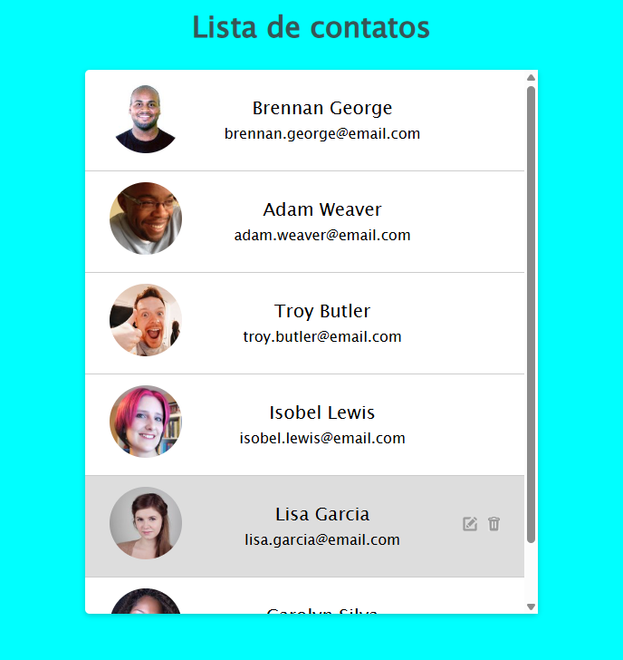

# Lista de Contatos
Projeto prático para construção de uma interface de gerenciamento/exibição de contatos, focando no domínio de componentes de lista e rolagem.

## 🚀 Tecnologias Utilizadas
- HTML5
- CSS3 (Flexbox)

## 💡 Aprendizados e Conceitos Aplicados
- **Propriedades de Transbordo:** Aplicação de `overflow-y` para controle de rolagem interna em listas restritas.
- **Herança CSS:** Prática para evitar a repetição desnecessária de atributos já herdados do elemento pai.
- **Layout de Cards:** Organização visual de dados de contato (foto, nome e e-mail) em estruturas de cards reutilizáveis.

